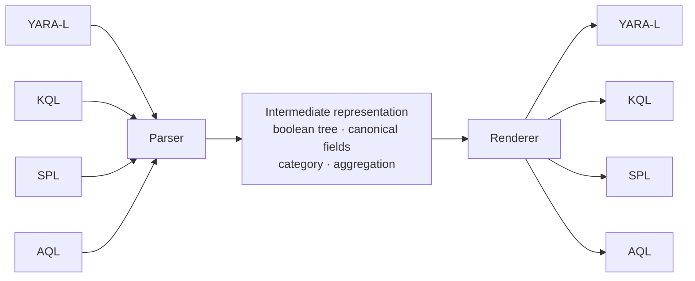

<div align="center">

# 🪨 rosetta-siem

### The Rosetta Stone for SIEM queries: translate detections between Google SecOps, Sentinel, Splunk and QRadar

**YARA-L 2.0 ⇄ KQL ⇄ SPL ⇄ AQL · zero dependencies · honest warnings instead of silent mistranslation**

[](https://github.com/rizwancyberlock-svg/rosetta-siem/actions/workflows/test.yml)


</div>

---

## Why

Every SOC that migrates SIEMs, runs two SIEMs, or wants to reuse a community rule hits the same wall: **detections are written in incompatible languages with incompatible field names.**

- Sigma helps if your rule is already in Sigma. Most of your rules aren't.
- Vendor migration tools usually translate *into* their own product only.
- Hand-translating hundreds of rules takes weeks, and errors are silent.

`rosetta-siem` translates **directly between the four query languages** most enterprise SOCs actually use, in **any direction**:

| Language | Platform | Field model used |
|---|---|---|
| **YARA-L 2.0** | Google Security Operations (Chronicle) | UDM |
| **KQL** | Microsoft Sentinel / Defender XDR | ASIM (`_Im_*` parsers) + native tables |
| **SPL** | Splunk | CIM (+ Sysmon / Windows native names) |
| **AQL** | IBM QRadar | QRadar event properties |

## Quick start

```bash
git clone https://github.com/rizwancyberlock-svg/rosetta-siem && cd rosetta-siem
python -m rosetta convert --to all examples/rdp_bruteforce.aql
```

No `pip install` needed. Optional: `pip install .` gives you a `rosetta` command.

**Input (QRadar AQL)**
```sql
SELECT sourceip, COUNT(*) FROM events WHERE "EventID" = '4625' AND username NOT ILIKE '%$'
GROUP BY sourceip HAVING COUNT(*) >= 20 LAST 15 MINUTES
```

**Output: Google SecOps YARA-L**
```
rule converted_rule {
  events:
    $e.metadata.event_type = "USER_LOGIN"
    $e.metadata.product_event_type = "4625"
    not $e.target.user.userid = /\$$/
    $e.principal.ip = $ip
  match:
    $ip over 15m
  condition:
    #e >= 20
}
```

**Output: Microsoft Sentinel KQL (ASIM)**
```kql
_Im_Authentication
| where EventOriginalType == "4625"
    and not(TargetUsername endswith "$")
| summarize EventCount = count() by SrcIpAddr, bin(TimeGenerated, 15m)
| where EventCount >= 20
```

**Output: Splunk SPL (CIM)**
```
index=* tag=authentication EventCode="4625" NOT user="*$"
| bin _time span=15m
| stats count AS event_count BY _time src
| where event_count>=20
```

## Usage

```bash
# one file, one target (source language inferred from extension)
python -m rosetta convert --to kql rule.yaral

# several targets, or all
python -m rosetta convert --to spl,aql query.kql
python -m rosetta convert --to all query.spl

# stdin
echo 'index=* EventCode=4688 process="*mimikatz*"' | python -m rosetta convert --from spl --to yaral -

# a whole rule library, with a report
python -m rosetta batch --from yaral --to kql,spl,aql --in rules/ --out translated/

# show the field mapping table
python -m rosetta fields
```

Python API:
```python
from rosetta import convert
query, warnings = convert(spl_text, "spl", "kql")
```

## Battle-tested on a real library

All 312 rules of [open-yaral-detections](https://github.com/rizwancyberlock-svg/open-yaral-detections) were batch-converted to the other three languages ([report](examples/library-conversion-report.md)):

| Target | Converted | Not convertible |
|---|---:|---:|
| KQL | **309 / 312** | 3 |
| SPL | **309 / 312** | 3 |
| AQL | **309 / 312** | 3 |

The three rules it refuses are multi-event correlation rules (for example `$fail` followed by `$success`). A single KQL/SPL/AQL query can't express them faithfully, so rosetta says so instead of emitting something subtly wrong.

## How it works



1. **Parse** the source into an IR: `And` / `Or` / `Not` / `Cmp(field, op, value, nocase)` plus an optional aggregation (`count | distinct count` by fields over a window, with a threshold).
2. **Normalize fields** to canonical ECS-style names (`process.command_line`, `source.ip` ...). The mapping is category-aware: Splunk `user` is the *target* user on authentication events.
3. **Infer the event category** from YARA-L `metadata.event_type`, KQL table, Splunk tags or well-known Windows event IDs (4688 → process, 4625 → authentication ...).
4. **Render** with target idioms: `nocase` ↔ `=~` ↔ `ILIKE`, regex ↔ `matches regex` ↔ `match()` ↔ `IMATCHES`, CIDR ↔ `ipv4_is_in_range` ↔ `cidrmatch` ↔ `INCIDR`, thresholds ↔ `summarize` ↔ `stats` ↔ `HAVING`.
5. **Warn loudly** whenever meaning could change: unmapped fields, dropped functions, reference lists, AQL's single look-back window.

Literal regexes are simplified automatically, so `/\\powershell\.exe$/` becomes `endswith "\powershell.exe"`. The output reads the way a human would write it.

## Supported constructs

| Construct | YARA-L | KQL | SPL | AQL |
|---|:-:|:-:|:-:|:-:|
| equals / not equals (case-(in)sensitive) | ✅ | ✅ | ✅ | ✅ |
| contains / starts / ends with | ✅ | ✅ | ✅ (wildcards) | ✅ (LIKE) |
| regex | ✅ | ✅ | ✅ (`regex`, `match()`) | ✅ (MATCHES) |
| in-list | ✅ | ✅ | ✅ | ✅ |
| numeric comparisons | ✅ | ✅ | ✅ | ✅ |
| CIDR | ✅ | ✅ | ✅ | ✅ |
| AND / OR / NOT, nesting | ✅ | ✅ | ✅ | ✅ |
| count / distinct count by fields over window | ✅ | ✅ | ✅ | ✅ (look-back) |
| multi-event correlation | ❌ (explicit error) | - | - | - |
| reference lists / watchlists / lookups | ⚠ dropped with warning | ❌ | ❌ | ❌ |

## Field mappings

Run `python -m rosetta fields` for the full table. Highlights:

| Canonical | Google SecOps UDM | Splunk CIM | Sentinel ASIM | QRadar |
|---|---|---|---|---|
| `process.command_line` | `target.process.command_line` | `process` | `CommandLine` | `Process CommandLine` |
| `process.parent.path` | `principal.process.file.full_path` | `parent_process_path` | `ActingProcessName` | `Parent Process Path` |
| `user.name` | `principal.user.userid` | `user` | `ActorUsername` | `username` |
| `source.ip` | `principal.ip` | `src` | `SrcIpAddr` | `sourceip` |
| `destination.port` | `target.port` | `dest_port` | `DstPortNumber` | `destinationport` |
| `event.code` | `metadata.product_event_type` | `EventCode` | `EventOriginalType` | `EventID` |
| `url.full` | `target.url` | `url` | `Url` | `URL` |
| `dns.query` | `network.dns.questions.name` | `query` | `DnsQuery` | `DNS Query` |

Native names such as Sysmon `Image` / `CommandLine`, MDE `ProcessCommandLine` / `DeviceName` and SecurityEvent `NewProcessName` are accepted as input aliases. QRadar custom property names differ per DSM, so adjust [`rosetta/fields.py`](rosetta/fields.py) to match your deployment.

## Tests

```bash
python -m unittest discover -s tests -v
```

The suite includes parse tests for all four languages, cross-language rendering checks, and **round-trip tests** (`parse(render(rule)) == rule` for every language). If `open-yaral-detections` is checked out alongside, it also runs a library-wide conversion-rate test that requires at least 95%.

## Roadmap

- [ ] Sigma input/output
- [ ] Browser playground (Pyodide) on GitHub Pages
- [ ] Sentinel native-table output mode (DeviceProcessEvents, SigninLogs ...)
- [ ] Elastic EQL / ES|QL and CrowdStrike LogScale (CQL) targets
- [ ] Multi-event YARA-L → KQL `join` translation

## Part of a defender toolkit

| Repo | Role |
|---|---|
| [siem-onboarding-kit](https://github.com/rizwancyberlock-svg/siem-onboarding-kit) | Log-source onboarding guides for SecOps, Sentinel, Splunk and QRadar |
| [open-yaral-detections](https://github.com/rizwancyberlock-svg/open-yaral-detections) | 312 YARA-L detections |
| [sentinel-kql-detections](https://github.com/rizwancyberlock-svg/sentinel-kql-detections) | 208 validated Sentinel KQL detections |
| [soc-triage-playbooks](https://github.com/rizwancyberlock-svg/soc-triage-playbooks) | Investigate & respond |
| **rosetta-siem** (you are here) | Translate between SIEMs |

## Author

Built by **Rizwan Ahmed**, a Security Engineer focused on SIEM/SOAR, DAM and HSM. Contributions and new language backends are welcome.
